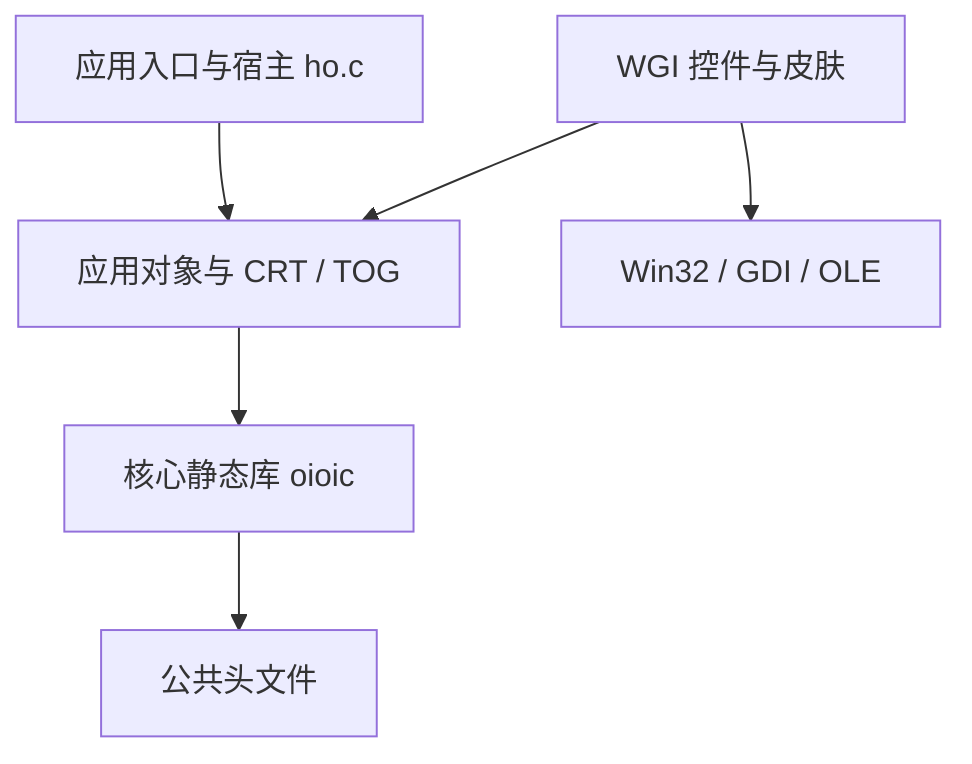

# 架构

## 模块边界

核心库负责对象结构、接口分派、继承节点查询、访问登记和字节队列。应用宿主负责对象构造选择、OID 分配回收、应用状态和程序入口。示例的 `ho.c` 属于应用，不应放入核心库。

`src/xmake.lua` 只声明核心静态库。根项目包含它，每个示例项目也分别包含它；没有全局示例合集构建，示例间没有链接依赖。应用如需脱离仓库，可连同 `include/`、`src/` 一起分发并调整相对引用路径。

## 对象布局

`struct object` 保存对象模序号 MSN（`model_id`）、对象标识 OID（`oid`）、引用计数、九个接口指针、继承数组和扩展成员指针。OIOIC 是唯一根节点；最终派生节点 LND 位于 AND 数组首项。代码名称与原始资料的对应关系见[代码风格](coding-style.md)。

| 字段/概念 | 含义 |
| --- | --- |
| AND / `nodes` | 对象图中的节点数组 |
| AIB / `direct_bases` | 直接基节点及访问顺序 |
| ABN / `bases` | 所有基节点指针 |
| ACS / `callers` | 调用者访问记录席位 |
| `members` / `struct em_xxx` | 当前节点自己的业务状态 |
| `struct vr` 的 `cr` / `mr` | 调用者与当前委托者标识 |

`crt_xxx` 分配并布置节点图；`tog_xxx` 绑定函数指针。构造代码使用 `size_t` 计算内存大小，并通过 `OIOIC_ALIGNED_SIZE` 对扩展成员块补齐，保证后续节点数据对齐。自定义成员若引入比 `struct object` 更严格的对齐需求，应同步升级构造布局，不能只修改结构体。

两栖车同时继承汽车和船，汽车与船都继承 vehicle。构造时 vehicle 及 OIOIC 各只有一份共享节点；调用者记录避免同一次继承访问重复处理共享节点。

## 调用与生命周期

典型流程：`create_object`、`vo_open`、`vo_interact*`/数据流接口、`vo_close`、`destroy_object`。创建与打开、关闭与销毁分别承担不同职责。调用前核对数据尺寸，调用后用 `RN`、`RO`、`RP` 判断结果域；不能仅检查返回值是否非零。

`vo_*` 登记访问并清除记录。直接调用接口指针会绕开登记机制。`OBS_*` 先访问基节点，`SBO_*` 先处理当前节点；专用中性结果码控制继续分派。带下划线的宏有不同的中继约定，修改前阅读公共头文件。

`interact0` 无数据流，`interact1` 仅输出，`interact2` 仅输入，`interact3` 同时输入输出。应用行为码必须在对应的 `AC0_`、`AC1_`、`AC2_`、`AC3_` 起点上扩展，避免与核心命令重合。

调用者记录、引用计数、队列及宿主 OID 分配没有自动同步保障。多线程访问需要应用提供锁和生命周期约束。

## 平台与代码生成

公共核心不包含 Win32 头文件，64 位类型采用 `stdint.h`，OS 标识按编译目标选择。核心静态库可独立编译；应用提供其所用创建/销毁入口。

WGI 把 Windows 依赖限制在自身目录：Unicode API、指针宽度正确的窗口用户数据、OLE 图片加载、资源图标及独立部署的 `skins/`。它依然是 Windows 示例，未改写为跨平台图形库。

`oicc` 的 `<ibn>` 标记声明直接基节点，`<crt>` 区域保存生成的构造函数。现存工具没有源码，默认构建直接编译已迁移的 C 文件。运行旧工具后需要重新审查 API、对齐和资源清理，不能把原输出直接视为现代构建的正确结果。
