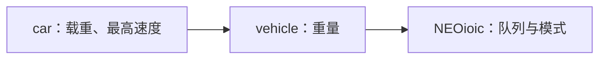
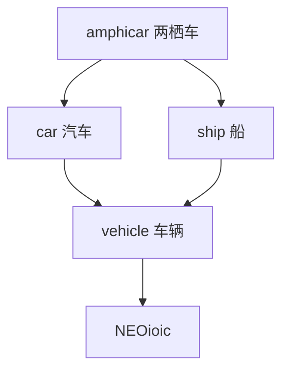

# NEOioic：从第一个对象开始

NEOioic 来源自 OIOIC，是以 C 实现的对象模型及构造工具。它用结构体保存状态，用函数指针提供接口，用节点图表达继承关系。

本教程面向了解 C 结构体、指针和动态内存的初学者，以当前仓库的 C11 API 为准。建议准备好源码，一边运行 `examples/single_inheritance`，一边阅读。历史教材中的 1.0.6 API、VC6 截图以及旧工具生成的名称不适用于直接编译当前项目。

文中的文件路径均相对于**源码仓库根目录**。GitHub Wiki 是独立仓库，复制本页后，代码路径仍应在源码仓库中查找，不是 Wiki 中的页面链接。

## 目录

- [1. 先理解三个角色](#1-先理解三个角色)
- [2. 准备环境并运行示例](#2-准备环境并运行示例)
- [3. 对象内部是什么样的](#3-对象内部是什么样的)
- [4. 创建并使用一辆汽车](#4-创建并使用一辆汽车)
- [5. 统一接口和字节流](#5-统一接口和字节流)
- [6. 给汽车增加一个设置接口](#6-给汽车增加一个设置接口)
- [7. 继承接口如何找到实现](#7-继承接口如何找到实现)
- [8. 多继承与共享基节点](#8-多继承与共享基节点)
- [9. 构造函数和接口绑定](#9-构造函数和接口绑定)
- [10. 输入输出队列](#10-输入输出队列)
- [11. 生命周期与失败清理](#11-生命周期与失败清理)
- [12. 建立自己的应用](#12-建立自己的应用)
- [13. 常见问题与下一步](#13-常见问题与下一步)

## 1. 先理解三个角色

可以把 NEOioic 应用理解为三个协作的部分：

| 角色 | 职责 | 对应代码 |
| --- | --- | --- |
| 核心运行时 | 对象结构、访问登记、继承辅助与字节队列 | `include/`、`src/` |
| 业务节点 | 定义状态，实现打开、查询、设置等行为 | 示例的 `objects/general/` |
| 应用宿主 | 选择构造函数、分配回收 OID、管理对象和入口 | 示例的 `host.c`、`host.h`、`objects/application/main/main.c` |

例如，一个汽车节点知道如何查询最大载重；宿主知道如何创建汽车；主程序决定何时创建、打开、查询和销毁它。核心库不会替应用决定业务对象类型。

NEOioic 没有额外的语言编译器。最终编译的是普通 C 文件。`oicc` 是历史构造工具，当前构建直接使用已迁移的 C 构造代码，不需要运行它。

## 2. 准备环境并运行示例

需要支持 C11 的编译器和 xmake。Windows 可使用完整 MinGW-w64 工具链，包含 `gcc`、`ar`；WGI 还需要 `windres`。项目已有 Windows x86_64、MinGW-w64 GCC 15.1 和 xmake 2.9.6 的验证记录。

在源码仓库根目录打开 PowerShell，执行下面的命令。请把工具链路径换成本机实际目录：

```powershell
cd examples/single_inheritance
xmake f -P . -p mingw --mingw="D:/path/to/mingw64" -a x86_64 -m debug
xmake -P .
xmake run -P . single_inheritance
```

预期输出：

```text
car's weight is 1.010000 ton.
car's max-load is 1.530000 ton.
car's max-velocity is 186.500000 km/h.
```

Linux/macOS 的核心与控制台示例可按下面的方式选择 GCC；使用 Clang 时把 `gcc` 改为 `clang`：

```sh
cd examples/single_inheritance
xmake f -P . --toolchain=gcc -m debug
xmake -P .
xmake run -P . single_inheritance
```

这里的 `-P .` 很重要：它明确选择当前项目，避免 xmake 命中此前记住的根项目。每个示例有独立配置和输出目录，不需要先在根目录构建核心，也不需要构建其他示例。

| 项目目录 | 构建目标 | 学习内容 |
| --- | --- | --- |
| 仓库根目录 | `neoioic` | 只生成核心静态库 |
| `examples/hello_world` | `hello_world` | 编译环境和程序入口 |
| `examples/single_inheritance` | `single_inheritance` | 完整的创建、打开、查询和释放流程 |
| `examples/multiple_inheritance` | `multiple_inheritance` | 两栖车、菱形继承、共享基节点 |
| `examples/wgi` | `wgi` | Windows 窗口、控件和皮肤 |

Hello World 当前只直接打印文本，它的节点构造区和宿主创建分支尚未填写，不能把它当作完整对象生命周期示例。WGI 使用 Win32/GDI/OLE，属于 Windows GUI 示例。

## 3. 对象内部是什么样的

### 模型、对象和节点

`model_id` 表示“是什么模型”，例如 `MSN_CAR`；`oid` 表示“具体是哪一个节点实例”。同一种模型可以创建多个对象，它们的模型号相同，但实例标识不同。

在 NEOioic 中，一辆完整的汽车由多个 `struct object` 节点组成：汽车、车辆和 NEOioic 根节点。它们共同构成一个对象图。每个节点都有自己的状态、引用计数和接口。



箭头表示“派生节点继承基节点”。`car` 是最终派生节点；`NEOioic` 是继承根节点。

汽车自己的状态定义在 `objects/general/car/car.h`：

```c
struct em_car {
	float max_load;
	float max_velocity;
};
```

在汽车接口内部，`self` 指向当前汽车节点：

```c
struct em_car *members = self->members;
struct em_vehicle *vehicle = get_base_members(self, MSN_VEHICLE);
```

前者取得当前节点状态，后者查找基节点状态。`get_base_members` 和 `get_base_node` **只查基节点，不查自身**；查不到时返回 `NULL`。业务设计不保证继承关系时，要先检查查询结果。

### 读懂四个数组名

阅读 CRT 构造代码时，会遇到下面四个概念：

| 名称 | 代码成员 | 含义 | 汽车中的例子 |
| --- | --- | --- | --- |
| AND | `nodes` | 完整对象的节点数组，首项为最终派生节点 | car、vehicle、NEOioic |
| AIB | `direct_bases` | 当前节点直接继承哪些节点，以及访问顺序 | car 的直接基节点是 vehicle |
| ABN | `bases` | 当前节点全部基节点 | car 的基节点是 vehicle、NEOioic |
| ACS | `callers` | 当前访问上下文的登记席位 | 用于识别重复访问 |

这些关系由构造代码建立。业务代码通常只需要使用 VO 接口、`self->members` 和基节点查询函数。

## 4. 创建并使用一辆汽车

先掌握这条生命周期：

```text
创建对象 → 打开对象 → 查询/设置/传输数据 → 关闭对象 → 销毁对象
```

创建安排内存、节点图和标识；打开准备业务状态；关闭结束使用、释放业务资源；销毁回收存储与标识。这几个动作不能互相替代。

### 一个可以运行的入口

下面的代码可以**整体替换** `examples/single_inheritance/objects/application/main/main.c`，使用现有宿主、汽车构造函数和核心库。建议在工作副本中操作，以便随时恢复原示例。

```c
#include <stdio.h>
#include <stdlib.h>
#include "main.h"

int main(void)
{
	struct object *car = NULL;
	struct vr caller = { OID_MAIN, OID_FACTORY };
	float max_load = 0.0f;
	unsigned int quantity = 0;
	int status = EXIT_FAILURE;
	int result;

	result = create_object(MSN_CAR, 0, 0, 1, &car);
	if (RN(result)) {
		fprintf(stderr, "create failed: %d\n", result);
		return EXIT_FAILURE;
	}

	result = vo_open(car, &caller);
	if (!RP(result)) {
		fprintf(stderr, "open failed: %d\n", result);
		if (result == RN_CLOSEPARTIAL)
			goto close_car;
		goto destroy_car;
	}

	result = vo_interact1(car, GET_MAXLOAD,
			      (unsigned char *)&max_load, sizeof(max_load),
			      &quantity, &caller);
	if (RP(result) && quantity == sizeof(max_load)) {
		printf("max load: %.2f ton\n", max_load);
		status = EXIT_SUCCESS;
	} else {
		fprintf(stderr, "query failed: %d, bytes: %u\n",
			result, quantity);
	}

close_car:
	result = vo_close(car, &caller);
	if (result != RP_RCZERO) {
		fprintf(stderr, "close incomplete: %d\n", result);
		/* 持续运行的应用应保留 car，排除原因后继续清理。 */
		return EXIT_FAILURE;
	}

destroy_car:
	destroy_object(car);
	if (car != NULL) {
		fprintf(stderr, "destroy failed\n");
		return EXIT_FAILURE;
	}
	return status;
}
```

在该示例目录重新执行构建和运行命令，正常输出为 `max load: 1.53 ton`。

这个教学程序遇到关闭失败会报错退出，不提供自动重试循环。在服务器或 GUI 等持续运行的应用中，必须把尚待清理的对象保留在拥有者状态中，待失败原因消除后重试，不能丢弃指针或强行释放。

### 创建参数是什么意思

```c
create_object(MSN_CAR, 0, 0, 1, &car);
```

| 参数 | 含义 |
| --- | --- |
| `MSN_CAR` | 选择宿主中登记的汽车构造分支 |
| 第一个 `0` | 输入队列容量，单位为字节 |
| 第二个 `0` | 输出队列容量，单位为字节 |
| `1` | 调用者容量，CRT 据此安排各节点的访问席位 |
| `&car` | 接收最终派生节点指针 |

本例只查询属性，所以不需要队列。`caller_capacity` 必须大于零，它不是线程数，也不意味着访问会自动串行化。

`create_object` 是 `host_create_object(..., NULL)` 的宏包装。宿主根据模型号调用 `crt_car`。没有加入宿主创建分支的新模型，即使写好了接口，也不能通过这个入口创建。

### 为什么需要 `caller`

```c
struct vr caller = { OID_MAIN, OID_FACTORY };
```

`struct vr` 保存调用上下文：`cr` 是调用者，`mr` 是当前委托者。这里 main 发起调用，宿主标识是 Factory，两个 OID 在该示例的 `host.h` 中定义。调用者可以有 OID 而没有实际分配的对象节点。

两个字段都必须非零。ACS 以 `(cr, mr)` 判断重复访问，空席位以 `cr == 0` 标记。VO 包装函数在进入接口前登记，在结束时清除当前节点及基节点上的对应记录。

业务调用应使用 `vo_open`、`vo_interact1` 等 `vo_*` 函数。直接调用 `car->interact1(...)` 会绕过该入口的登记机制。

## 5. 统一接口和字节流

### 五类接口为什么有九个函数

Open、Input、Output、Interact、Close 是概念上的五类接口；运行时还提供输入输出组合，并按数据方向细分 Interact，最终有九个函数指针：

| VO 函数 | 用途 | 数据方向 |
| --- | --- | --- |
| `vo_open` | 打开 | 无字节流 |
| `vo_input` | 输入数据 | 输入 |
| `vo_output` | 读取数据 | 输出 |
| `vo_io_put` | 输入并取得输出 | 输入、输出 |
| `vo_interact0` | 执行行为 | 无字节流 |
| `vo_interact1` | 执行查询 | 输出 |
| `vo_interact2` | 执行设置等行为 | 输入 |
| `vo_interact3` | 按输入取得计算结果等 | 输入、输出 |
| `vo_close` | 关闭 | 无字节流 |

`interact*` 还接收一个 `action` 行为码，表示“这次要做什么”。例如 `GET_MAXLOAD` 表示查询最大载重。

### 行为码必须和接口匹配

| 类别 | 自定义行为起点 | 应调用的接口 |
| --- | --- | --- |
| AC0 | `AC0_` | `vo_interact0` |
| AC1 | `AC1_` | `vo_interact1` |
| AC2 | `AC2_` | `vo_interact2` |
| AC3 | `AC3_` | `vo_interact3` |

例如在一个新应用中，可以集中定义：

```c
#define CMD_START (AC0_ + 0)
#define GET_VALUE (AC1_ + 0)
#define SET_VALUE (AC2_ + 0)
#define CALCULATE (AC3_ + 0)
```

同一类别的编号需要在应用内协调，特别是同一个继承图能够接收到的命令。不要让两个不同含义的行为撞号，也不要随意使用 `0`、`1` 与核心命令重合。

传错 AC 类别违反 VO 调用契约；当前包装器主要用断言检查类别，Release 不保证替你拒绝错误调用。应用应在调用前选对接口。

### 返回值不是布尔值

接口返回统一的 `int`，通过以下宏判断结果域：

```c
if (RN(result)) {
	/* 否定结果，例如参数错误、资源不足。 */
} else if (RO(result)) {
	/* 中性结果，例如空操作、继续分派。 */
} else if (RP(result)) {
	/* 肯定结果。 */
}
```

不要用 `if (result)` 或简单的正负号代替它们。中性结果也可能是正数或负数。

| 结果 | 含义 |
| --- | --- |
| `R_P` | 一般肯定结果 |
| `RP_RCONE` | 此接口约定引用计数变为 1 |
| `RP_RCZERO` | 此接口约定关闭后引用计数归零 |
| `RN_INVALIDARG` | 参数不满足约定 |
| `RN_FULL` | 引用计数达到上限 |
| `RN_UNSHARED` | 非共享对象拒绝重复打开 |
| `RN_LACKOID` | 宿主没有足够的节点标识可供分配 |
| `RN_LOST` | 队列存在数据丢失 |
| `RO_VAINLY` | 空操作，例如空队列出列 |
| `RO_NOPEN` | 对未打开节点执行关闭 |
| `RN_CLOSEPARTIAL` | 对象已部分关闭，必须继续清理 |

`RP_RCONE`、`RP_RCZERO` 是具体接口的返回约定，不能要求所有节点都返回它们。当前 `car_close` 在归零时返回 `RP_RCZERO`，NEOioic 根节点关闭归零仍返回 `R_P`。

### 字节流需要双方约定类型和长度

NEOioic 使用 `unsigned char *` 传输数据。指针本身没有说明数据是整数、浮点数还是结构体，调用者和接口实现必须约定：

- 输入是什么类型，`quantity` 应为多少字节。
- 输出是什么类型，调用者应提供多大 `capacity`。
- 成功、失败或部分输出时，`output_quantity` 表示多少有效字节。

把 `float` 的地址转换为字节指针没有执行类型转换，只是在传递该值的内存表示。接收端适合用 `memcpy` 读写值，避免把任意字节地址强制解引用为未对齐的数值指针。声明 `memcpy` 需要 `<string.h>`。

当前汽车查询示例仍有用 `assert` 检查容量并直接写 `float` 的教学实现。因此调用现有查询时必须提供对齐正确、容量足够的 `float` 变量；不要假定所有业务接口都能安全拒绝短缓冲区。编写新接口时，应像下一节一样保留 Release 中有效的长度检查。

这些字节是本机 C 类型的内存表示，**不是网络序列化格式**。保存到文件或跨机器传输时，还需要自行定义字节序、字段宽度和格式版本。

## 6. 给汽车增加一个设置接口

下面在单继承示例中增加“设置最大载重”行为。它复用已有 `max_load`，无需增加成员，也无需改变 CRT 布局。

### 第一步：定义命令

在 `examples/single_inheritance/host.h` 中增加：

```c
#define SET_MAXLOAD (AC2_ + 0)
```

这个示例目前没有占用该 AC2 行为。其他项目要先检查本应用已有编号。不要再重复定义已经存在的 `GET_MAXLOAD`。

### 第二步：实现输入处理

在 `objects/general/car/car.c` 中，将原来的 `car_interact2` 整体替换为：

```c
static int car_interact2(struct object *self, unsigned int action,
			 unsigned char *input_stream, unsigned int quantity,
			 const struct vr *caller_context)
{
	struct em_car *members = self->members;
	float max_load;

	if (action != SET_MAXLOAD) {
		SBO_OBJECT_INTERACT2;
	}
	if (input_stream == NULL || quantity != sizeof(max_load))
		return RN_INVALIDARG;

	memcpy(&max_load, input_stream, sizeof(max_load));
	if (!(max_load >= 0.0f && max_load <= members->max_load))
		return RN_INVALIDARG;

	members->max_load = max_load;
	return R_P;
}
```

这里把行为约定为“在当前上限以内下调载重”，因此允许范围取决于已有状态，没有额外保存一份可推导的上限。条件也会拒绝 NaN 和无穷大的浮点输入。若业务需要任意修改额定载重，应重新定义合法范围及其来源。

`car.c` 已包含 `<string.h>`。未识别的命令交给原有的 `SBO_OBJECT_INTERACT2` 宏；该宏自身包含 `return`，调用时不能写成 `return SBO_OBJECT_INTERACT2;`。

### 第三步：从应用调用

在上一节完整入口中，`vo_open` 成功之后、`GET_MAXLOAD` 查询之前插入：

```c
	max_load = 1.20f;
	result = vo_interact2(car, SET_MAXLOAD,
			      (unsigned char *)&max_load,
			      sizeof(max_load), &caller);
	if (!RP(result)) {
		fprintf(stderr, "set failed: %d\n", result);
		goto close_car;
	}
```

重新构建运行，查询结果应变为 `max load: 1.20 ton`。将输入改为负数或比当前上限更大的数，设置应返回 `RN_INVALIDARG`，原状态保持不变。

可以再尝试传入非空字节缓冲区，但把长度设为 `sizeof(float) - 1`，验证短输入被拒绝。不要通过传空指针来测试 VO：其调用前置条件在 Debug 下会触发断言。

新增查询接口也采用同样思路：匹配行为、检查容量、用 `memcpy` 输出、填写 `*output_quantity`、返回结果。输出数量应在失败路径保持明确，通常先置零。

## 7. 继承接口如何找到实现

调用 `vo_interact1(car, GET_WEIGHT, ...)` 时，重量并不在 `struct em_car` 中。汽车接口处理不了它，就把调用交给车辆接口：

```text
调用者 → VO 登记 → car_interact1
                     ├─ GET_MAXLOAD：汽车直接回答
                     └─ GET_WEIGHT：委托 vehicle_interact1 回答
          ← 返回结果并清除访问记录
```

### OBS 和 SBO

| 顺序 | 全称 | 含义 |
| --- | --- | --- |
| OBS | others before self | 先基节点，再当前节点 |
| SBO | self before others | 先当前节点，再基节点 |

接口常用如下结构。以下是结构示意，省略了已有业务代码：

```c
static int car_open(struct object *self, const struct vr *caller_context)
{
	OBS_OBJECT_OPEN_;
	/* 基节点打开成功后，初始化汽车自己的状态。 */
	return R_P;
}
```

普通数据和行为接口通常先处理自己的行为，再以 `SBO_OBJECT_INPUT`、`SBO_OBJECT_INTERACT1` 等宏结尾。宏使用固定参数名，例如 `self`、`input_stream`、`caller_context`；复制接口模板时要保留这些名称。

### 接力和非接力

访问顺序之外，还要决定是否继续访问其他分支：

| 宏形式 | 方式 | 继续访问条件 |
| --- | --- | --- |
| `OBS_OBJECT_INTERACT1` | OBS 非接力 | 基节点返回 `RO_OBSOIX` 才继续 |
| `SBO_OBJECT_INTERACT1` | SBO 非接力 | 基节点返回 `RO_SBOOIX` 才继续 |
| `OBS_OBJECT_INTERACT1_` | OBS 接力 | 遍历基节点，再由当前节点给出结果 |
| `_SBO_OBJECT_INTERACT1` | SBO 接力 | 当前节点之后遍历基节点 |

表中用 `interact1` 举例，其他数据/行为接口也有对应形式。接力 SBO 在单继承时传递基节点结果，多继承时返回专用中性结果 `RO__SBOOIX`。不要把它替换成一般成功，也不要用“只要不是失败就停止”改写非接力宏，否则会改变分派行为。

打开和关闭使用专门的 `OBS_OBJECT_OPEN_`、`OBS_OBJECT_CLOSE_`，有引用计数、失败清理和部分关闭处理；不能把普通接力访问“不看结果继续”的理解套到生命周期失败上。

需要从当前节点主动调用另一个对象时，可以使用新的局部上下文：

```c
struct vr caller = {
	.cr = caller_context->cr,
	.mr = self->oid,
};
```

它保留原始调用者，把委托者改为当前节点。是否需要新委托应由对象职责决定，不应为了绕开重复访问检查而随意更换标识。普通继承转发交给现有宏即可，不要修改传入的 `caller_context`。

## 8. 多继承与共享基节点

从仓库根目录进入 `examples/multiple_inheritance`，按前面的流程配置、构建并运行目标 `multiple_inheritance`。

它的继承关系如下：



一辆两栖车拥有汽车和船两套性能，但只共享一份 `vehicle` 和一份 `NEOioic`。其 AND 包含五个节点：`amphicar`、`car`、`ship`、`vehicle`、`NEOioic`，不是两条继承链各分配一份。

因此：

- 重量来自同一个 `struct em_vehicle`。
- 陆上载重和速度来自 `struct em_car`。
- 水上载重和速度来自 `struct em_ship`。
- 输入输出队列属于共同的 NEOioic 根节点。

`amphicar_open` 给共享重量和两套性能赋值。查询使用 `GET_WEIGHT`、`GET_TMAXLOAD`、`GET_TMAXVELOCITY`、`GET_AMAXLOAD`、`GET_AMAXVELOCITY`。`T` 指陆上，`A` 指水上。示例两栖车的重量为 4.06 吨，陆上最大载重 10.93 吨，水上最大载重 12.5 吨。

共享基节点会从两条路径被遇到；ACS 根据同一个 `(cr, mr)` 识别已经访问过的节点，防止同一次分派重复处理。这种机制并不等于互斥锁，也不保证并发安全。

## 9. 构造函数和接口绑定

### CRT 负责布局，TOG 负责绑定

| 函数 | 作用 |
| --- | --- |
| `crt_car` | 分配/清零构造区，安排节点、关系、访问席位、状态及队列 |
| `tog_car` | 将汽车节点的九个函数指针绑定到实现 |
| `car_open` | 执行汽车的打开逻辑，初始化业务状态 |

它们有不同职责。不要把打开操作当作内存构造，也不要把业务逻辑塞进 `<crt>` 区域。

在 `car.c` 中可以看到完整绑定：

```c
void tog_car(struct object *object)
{
	object->open = car_open;
	object->input = car_input;
	object->output = car_output;
	object->io_put = car_io_put;
	object->interact0 = car_interact0;
	object->interact1 = car_interact1;
	object->interact2 = car_interact2;
	object->interact3 = car_interact3;
	object->close = car_close;
}
```

即使某个接口没有业务逻辑，也要绑定到能正确转发或返回中性结果的实现，不能留下未初始化的函数指针。

### 沿着 `crt_car` 阅读

完整构造函数位于 `examples/single_inheritance/objects/general/car/car.c`。按以下顺序阅读：

1. 计算节点数、基节点指针数、直接基节点指针数、访问席位数和扩展成员大小。
2. 检查 `caller_capacity`，动态分配构造区，或清零调用者提供的外部存储。
3. 按 AND 顺序初始化 car、vehicle、NEOioic，设置模型号、OID、`nodes` 和 `node_count`，调用各自 TOG。
4. 为每个节点安排 AIB、ABN、ACS 和 `members`，逐段推进内存指针。
5. 按容量分别分配输入、输出队列；发生失败时释放已经申请的资源。
6. 返回最终派生节点，由宿主完成 OID 管理。

汽车 CRT 中，三个节点的席位分别是调用者容量的 1、2、3 倍，总席位为 6 倍。构造前检查的是最大单节点倍数能否放入 `unsigned short caller_count`，不能只检查总内存是否足够。

尺寸计算使用 `size_t`。扩展成员块应使用：

```c
size_t member_bytes = NEOIOIC_ALIGNED_SIZE(struct em_car)
		    + NEOIOIC_ALIGNED_SIZE(struct em_vehicle)
		    + NEOIOIC_ALIGNED_SIZE(struct em_neoioic);
```

增加字段后，既要检查总大小，也要检查推进 `p` 的每一步。该宏按 `struct object` 的对齐要求补齐成员块；如果引入更严格对齐的类型，必须重新设计并核对布局，不能认为宏自动解决所有类型的对齐。

### 不必为每个基节点单独创建对象

`crt_car` 构造了整个汽车对象图，复用 `tog_vehicle` 和 `tog_neoioic`。作为其内部基节点存在的 `vehicle` 不一定需要独立 CRT。只有需要独立创建某种完整对象时，才需要相应的构造和宿主选择分支。

基节点指针位于同一个构造区，**不能独立 `free` 或对其调用 `destroy_object`**。对象拥有者应持有最终派生节点，并统一管理整张图。

### 关于 `oicc`

源文件中的 `<ibn>` 声明直接继承关系，`<crt>` 保存构造代码。仓库仅提供旧版 oicc 预编译二进制，没有可重建工具的源码；默认构建也不会执行它。

旧生成器可能覆盖 `<crt>`，而且不会自动满足当前命名、对齐、席位检查、外部存储初始化和失败清理规则。不要把重新生成当作无条件安全的更新步骤。需要使用时先在临时副本实验，参照 `tools/oicc/README.md` 逐项审查差异。

## 10. 输入输出队列

### 队列属于谁

`struct em_neoioic` 保存 `iq`（输入队列）、`oq`（输出队列）和模式位 `mds`。派生节点可通过 `get_iq(object)`、`get_oq(object)` 取得基节点队列。它们同样只查基节点；直接持有 NEOioic 根节点时，应通过其 `members` 取队列。

核心根节点的 `input`、`output` 等接口并不自动把数据放入或取出队列，它们目前返回分派中性结果。若要实现管线或设备对象，需要业务节点明确调用 `enqueue`、`dequeue`，并定义自己的消费和生产逻辑。

### 独立队列操作示例

下面是可以放入函数中的局部示例，需要 `<stdio.h>` 和 `object.h`。容量单位都是字节：

```c
	unsigned char storage[4];
	unsigned char input[] = { 10, 20, 30 };
	unsigned char output[4];
	unsigned int quantity = 0;
	struct queue queue = {
		.data = storage,
		.capacity = sizeof(storage),
	};
	int result;

	result = enqueue(&queue, input, sizeof(input));
	if (!RP(result))
		fprintf(stderr, "enqueue result: %d\n", result);

	result = dequeue(&queue, output, sizeof(output), &quantity);
	if (RP(result) || result == RN_LOST)
		printf("read %u bytes\n", quantity);
```

未显式设置的结构体成员自动为零。空队列 `quantity == 0`，`front`、`rear` 均为 `NULL`；非空时它们指向数组内首、尾有效字节，不是数组前一位置的哨兵。

入列空间不够时，`enqueue` 放入能容纳的部分，并以 `RN_LOST` 和 `lost` 通知丢失数量。出列遇到已有丢失标记时，也可能返回 `RN_LOST`，但已经取得数据；必须同时检查 `output_quantity`。有数据的出列会清除此前丢失标记，空队列出列返回 `RO_VAINLY`。

队列函数要求合法状态和有效缓冲区，出列容量必须非零。单字节宏还有“队列有空位”“队列非空”等前置条件，初学阶段优先使用 `enqueue`、`dequeue`。

### 通过行为改变对象队列容量

下面的片段用于已有、已打开的汽车对象，沿用完整入口中的 `car`、`caller` 和 `result`：

```c
	unsigned int capacity = 1024;
	unsigned int actual = 0;

	result = vo_interact2(car, SET_IQCTY,
			      (unsigned char *)&capacity, sizeof(capacity),
			      &caller);
	if (!RP(result)) {
		fprintf(stderr, "resize failed: %d\n", result);
		goto close_car;
	}

	result = vo_interact1(car, GET_IQCTY,
			      (unsigned char *)&capacity, sizeof(capacity),
			      &actual, &caller);
	if (RP(result) && actual == sizeof(capacity))
		printf("input queue capacity: %u\n", capacity);
```

输出队列使用 `SET_OQCTY`、`GET_OQCTY`。设置输入必须恰好是一个本机 `unsigned int`；查询输出缓冲区至少同样大小。

**设置容量成功会清空旧数据和丢失标记，即使容量数值没变也是如此。** 设置为零禁用队列；申请新缓冲区失败则保留旧队列和数据。`CMD_RESET` 清空两队列而保留容量。

### 模式名称与位值

模式位沿用原模型的编码：`MOD_SHARED` 位为 0 表示共享，`MOD_BLOCKI`、`MOD_BLOCKO` 位为 0 表示阻断，置 1 表示相反含义。建议通过 `SET_SHARED`、`SET_UNSHARED`、`SET_BLOCKI` 等行为操作，避免按名称直觉直接赋值。

这些标志并不意味着所有接口都会实现等待、唤醒或同步。业务节点仍需定义相应输入输出行为；“共享”也不等于线程安全。

## 11. 生命周期与失败清理

### 引用计数和资源所有权

每次成功打开都需要匹配一次关闭。一个对象被多方打开时，某次关闭成功可能只减少一个引用。应按具体节点接口约定确认最终关闭，再销毁整张图，不能每次 `vo_close` 后立即释放。

`destroy_object(car)` 宏先调用 `host_destroy_object(car)`；宿主回收 OID、释放队列，并返回布尔值。只有返回 `TRUE`，宏才 `free` 对象本体并把 `car` 置为 `NULL`。

注意这两个约定不同：对象接口返回 `int` 结果域，宿主销毁返回 `TRUE/FALSE`。检查销毁宏是否成功，可以看传入的指针是否已置空。销毁失败时应保留指针重试，不要直接补一个 `free`。

宿主销毁**不会替你调用关闭，也不自动检查对象是否仍打开**。业务资源必须先由关闭逻辑处理。

### 部分关闭不是回滚

多节点关闭过程中，可能已经关闭一部分基节点，然后才遇到失败。此时返回 `RN_CLOSEPARTIAL`，当前引用被保留以便再次清理。

收到这个结果后：

1. 保留对象和必要的调用上下文。
2. 停止业务访问，不再打开对象，也不直接销毁。
3. 排除失败原因，例如解除资源占用。
4. 重试 `vo_close`；现有关闭宏会跳过已经关闭的基节点。
5. 确认关闭完成、引用归零后再销毁。

打开失败时，内部回收已打开基节点的操作也可能失败，并返回同一个 `RN_CLOSEPARTIAL`，处理方式相同。不能把所有打开失败都写成直接销毁。

当前没有独立状态位在 VO 入口自动拦截部分关闭对象的业务访问。协议需要拥有者遵守，保留下来的引用不表示业务资源已恢复。

### 自定义打开和关闭

打开接口需要考虑重复打开是否会重复申请资源。示例汽车只设置数值，不能直接套用为文件、图像、窗口等资源的完整管理方案。

关闭接口在释放自身资源前，应完成可能失败的检查，正确向上传递失败和部分关闭结果。设计重试路径时要避免重复释放。不要在 `assert` 中执行打开文件、关闭句柄或销毁对象等必要动作，Release 中这些表达式可能根本不会执行。

### 外部存储是进阶功能

除动态分配外，`host_create_object` 还允许调用者提供构造区 `exotic_memory`。此时 `object_out` 必须为 `NULL`，二者互斥。

外部存储必须足够大、正确对齐，并在对象全部清理前保持有效。当前 API 不接收存储容量，无法替调用者验证。CRT 会清零整个构造区，但输入输出队列仍可能另外动态分配。

不要直接声明任意长度的 `unsigned char storage[]` 就强制转换为对象；大小和对齐都必须根据实际 CRT 核算。初学时优先使用动态创建。

外部存储对象完成关闭后，仅用 `host_destroy_object` 回收宿主记录和队列；宿主返回成功后，再由存储拥有者管理本体。**不能用会执行 `free(object)` 的 `destroy_object` 宏处理栈、静态或其他外部存储。**

### 并发访问需要应用同步

引用计数、ACS、队列、宿主 OID 分配回收均没有自动线程安全保证。多线程应用要明确锁的归属和对象生存期，既防止同时修改，也防止另一线程仍在访问时关闭或销毁。

## 12. 建立自己的应用

建议先复制一个已能运行的控制台示例到源码仓库的 `examples/` 同级示例位置，保留现有相对布局，然后逐步替换。将它移到其他位置时，需要同步调整核心路径。

```text
my_app/
    xmake.lua
    host.h                      模型号、行为码、宿主和入口 OID
    host.c                      构造选择、OID 分配与回收
    objects/
        application/main/       C 程序入口
        general/                业务节点及其状态
    support/                    应用辅助功能
```

新增一个模型可按以下顺序完成：

1. 明确对象职责、状态所有者和输入输出契约。
2. 在宿主头文件分配不冲突的 `MSN_XXX` 和行为码。
3. 定义 `struct em_xxx`，实现九个接口及 `tog_xxx`，确定继承分派方式。
4. 为需要独立创建的完整模型实现 CRT，建立 AIB、ABN、ACS 和状态布局，检查失败释放。
5. 在 `host_create_object` 的模型选择中加入该 CRT。
6. 在应用入口通过 `create_object` 和 VO 使用它，匹配关闭并检查销毁结果。

如果应用仍放在 `examples/my_app`，独立 `xmake.lua` 可以参照：

```lua
set_project("neoioic-my-app")
set_languages("c11")
set_targetdir(path.join(os.scriptdir(), "build/$(plat)/$(arch)/$(mode)"))
set_objectdir(path.join(os.scriptdir(), "build/.objs/$(target)/$(plat)/$(arch)/$(mode)"))
add_rules("mode.debug", "mode.release")
includes("../../src")

target("my_app")
    set_kind("binary")
    add_deps("neoioic")
    add_files("*.c", "objects/**.c")
    set_warnings("all")
```

有独立 `support/*.c` 时按需添加编译文件。不要把应用宿主加入核心库，也不要为新增示例修改根构建去集中声明所有示例目标。

源码采用 UTF-8、C11、小写下划线命名、8 列 Tab 缩进和显式 `struct` 类型。使用根目录 `.clang-format`、`.editorconfig`，详细规则见 `docs/coding_style.md`。

## 13. 常见问题与下一步

### 常见问题

| 现象 | 优先检查 |
| --- | --- |
| 只得到静态库，没有示例程序 | 是否在根目录构建；进入示例目录并使用 `-P .` |
| 模型号存在但创建失败 | 宿主是否登记 CRT；调用者容量、分配和 OID 是否成功 |
| 行为没有被处理 | AC 类型、编号冲突、TOG 绑定、基节点转发与中性结果 |
| 查询到的数值不对 | 两端类型是否一致、容量是否正确、输出数量是否匹配 |
| 基节点查询返回 `NULL` | 当前对象是否真的包含该基节点；是否把自身当成基节点查找 |
| 修改成员后崩溃 | CRT 总大小、各段偏移、对齐和构造代码是否同步 |
| Debug 正常、Release 出错 | 是否依赖断言执行动作或进行唯一的容量检查 |
| 调整队列容量后数据消失 | 成功设置容量会清空队列，是当前接口约定 |
| 出列返回失败却有输出 | `RN_LOST` 可伴随有效输出，应检查数量 |
| 关闭后资源仍不能销毁 | 是否仍有引用，或遇到 `RN_CLOSEPARTIAL` |
| WGI 找不到皮肤 | 运行目录与 `skins/` 部署是否正确，移动程序时是否一起移动资源 |

WGI 的对象指针通过 `GetWindowLongPtr`/`SetWindowLongPtr` 存入窗口数据，扩展时不能改成截断 64 位指针的 API。新增图片、位图、窗口或 OLE 资源时，要明确谁创建、谁持有、何时释放；完成 OLE 初始化后要配对清理。现有编译成功记录不代表所有 GUI 控件和资源失败路径都经过交互测试。

### 如何验证修改

先在受影响示例目录构建运行，检查结果和失败路径，再单独构建核心。切换 Release 时仍明确指定平台和工具链：

```powershell
# 以下从源码仓库根目录执行。
xmake f -P . -p mingw --mingw="D:/path/to/mingw64" -m release
xmake -P .

# 独立健壮性测试：配置、构建，再运行。
xmake f -P tests -p mingw --mingw="D:/path/to/mingw64" -m debug
xmake -P tests
xmake test -P tests -v
```

测试项目有 `robustness`、`dispatch` 两个目标，覆盖队列、分派、引用计数、部分关闭、构造失败与 OID 等。它使用 GNU 链接器包装注入分配失败，具体依赖见 `tests/README.md`；不能把任意平台上编译成功等同于失败路径已验证。重要改动还应切换 Release 再测，确认检查没有随 `NDEBUG` 消失。

### 推荐阅读顺序

| 想了解什么 | 阅读位置 |
| --- | --- |
| 项目概况 | `README.md` |
| 当前状态与验证边界 | `docs/handoff.md` |
| 架构、内存与生命周期契约 | `docs/architecture.md` |
| 平台构建与 CI | `docs/build.md` |
| 当前开发路径 | `docs/tutorial.md` |
| 全部函数原型、行为码和分派宏 | `include/object.h` |
| 根节点状态与容量命令实现 | `include/neoioic.h`、`src/neoioic.c` |
| 访问记录、队列和 VO 实现 | `src/object.c` |
| 构造布局及调用范例 | 两个继承示例中的 `car.c`、`amphicar.c`、`main.c` |
| 可执行的边界与失败案例 | `tests/README.md`、`tests/robustness.c`、`tests/dispatch.c` |
| 原始术语与设计背景 | `docs/primer/zh/index.htm`，仅作历史参考 |

项目当前许可证为根目录 `LICENSE` 中的 MIT，源码作者声明保留。历史教材中的旧许可说明不替代当前许可证。
